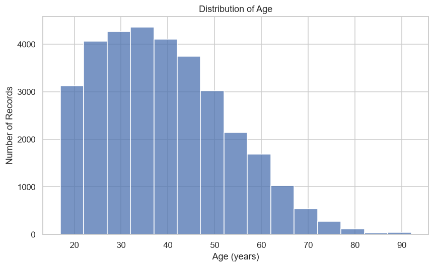
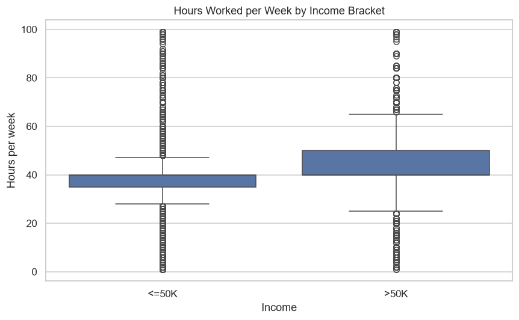
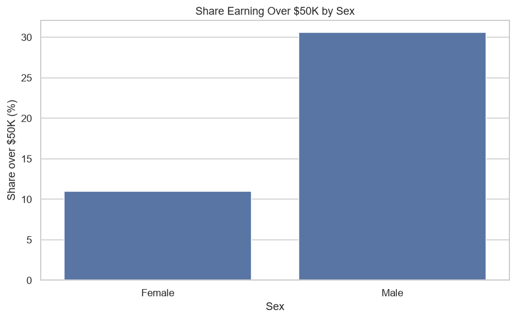
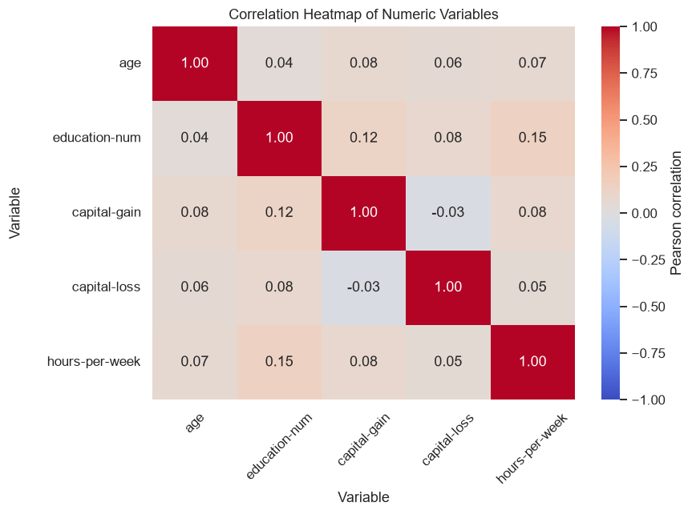

# Statistical Analysis Report: Income and Sex in the 1994 U.S. Census

`28 October 2026`

## Overview

I analyzed the UCI Adult (Census Income) dataset (Becker & Kohavi, `1996`) to test whether sex is associated with earning over $50K.
The dataset is publicly available at https://archive.ics.uci.edu/dataset/2/adult.
Of its `32,561` records, `7,841` (`24.08%`) sit over the $50K line.

This report covers the descriptive statistics, four visual models, and one chi-square test of independence.
The result of this analysis points to a clear discrepancy between men and women: men in this data earn over $50K far more often than women, `30.57%` against `10.95%`.
The chi-square test attributes the gap to far more than sampling noise, with a p-value of about `1e-332`.
The effect size, Cramér's V, is `0.2160`, a small-to-moderate association.

## Dataset Description

As noted in the Overview, the analysis uses the UCI Adult training extract (Becker & Kohavi, `1996`).
It is a real public extract of the `1994` U.S. Census, hosted by the UCI Machine Learning Repository.
Each row is one person, and `income` is the binary target of whether that person earns over $50K per year.

The table has `15` columns and `32,561` rows: `6` are numeric (`age`, `fnlwgt`, `education-num`, `capital-gain`, `capital-loss`, and `hours-per-week`) and `9` are categorical.
The test rests on the categorical pair `sex` and `income`, and the descriptive work follows the two numeric variables most relevant to the outcome, `age` and `hours-per-week`.

Three columns carry missing values (`workclass` `1,836`, `occupation` `1,843`, and `native-country` `583`, `4,262` cells in total).
I keep the missing values in place, because data cleanup is not the purpose of this project.
The `sex` and `income` columns are complete: all `32,561` rows carry a recorded value for both.
The test below therefore uses every row, and the missing cells in the other columns play no part in it.

The load check also flags `24` exact duplicate rows. I keep them, because a census extract can legitimately hold two people with identical recorded attributes.
One caution applies further down: the source is a household survey, and the `relationship` field lists husband, wife, and own-child entries, so the rows may not be independent.

## Methods

Lusa et al. (`2024`) set out the initial-data-analysis steps that should precede inference: data cleaning, a review of the missing values, and checks on the distribution and shape of each variable.
The argument is written for longitudinal studies, but the steps apply to any dataset.
Cleanup stays out of scope, which the Dataset Description records, so the screening before any test reduces to two steps: the load check covers the column types, the missing values, and the duplicates, and the descriptive statistics run the shape checks on `age` and `hours-per-week`.
That screening is the full data preparation, and its results shaped the choices below: a right-skewed `age` and two unbalanced variables (`income` and `sex`).

For the question itself I use a chi-square test of independence.
The question asks whether `sex` and `income` are associated rather than how much one predicts the other.
Both variables are categorical, which is exactly what the test expects.
The p-values come from a standard approximation that is only reliable when the expected counts are large, and the expected counts here (checked in the Results) sit far above that level.

The null hypothesis (H0) is that `sex` and `income` are independent.
The alternative (H1) is that they are associated. I fixed the significance level at alpha = `0.05` before the test.

A chi-square test is non-directional: it can say whether an association exists, not which way it runs, so I read the direction of the difference from the observed counts and rates rather than expecting the test to supply them.
A second assumption is that every row is a separate observation.
That one is not fully true here: the source is a household survey, records can share a household, and the p-value therefore reads only as approximate.
The Limitations section takes up that concern.

SciPy's `chi2_contingency` applies the Yates correction by default to a two-by-two table.
I report the uncorrected Pearson statistic (the effect size builds on it) and note the corrected value in the Results.
As an effect size I report Cramér's V, a `0`-to-`1` measure of the strength of an association (Cramér, `1946`).
The p-value alone does not show that strength and is easy to misread as the probability that the null hypothesis is true, so the p-value and the effect size travel together (Greenland et al., `2016`).

All computations used Python `3.12.14` with pandas `3.0.6`, NumPy `2.5.3`, and SciPy `1.18.1` (Virtanen et al., `2020`), and the figures used Matplotlib `3.11.2` and Seaborn `0.13.2`.
The notebook runs top to bottom from a clean kernel, writes the four figures itself, and prints every number the report quotes.
`requirements.txt` pins the exact package versions, and the notebook's Reproducibility section documents the whole rebuild with `uv` step by step, from the environment creation through the executed notebook.

## Results

The descriptive statistics show the shape and balance of the four relevant variables:

- `age` is right-skewed: the mean is `38.5816`, the median is `37.0`, the standard deviation is `13.6404`, the interquartile range is `28.0` to `48.0`, and the skewness is `0.5587`.
- `hours-per-week` concentrates at a `40`-hour week: the mean is `40.4375`, the median is `40.0`, the standard deviation is `12.3474`, the interquartile range is `40.0` to `45.0`, and the skewness is `0.2276`.
- `income` is unbalanced, with `7,841` people (`24.08%`) over $50K.
- `sex` is uneven, with `21,790` men and `10,771` women.

**Figure 1.** Distribution of age, showing the right skew.

The curve in Figure 1 falls the way the skewness number predicts, but the last populated bin needs its own reading.
The notebook's supporting counts show it holds `47` records, with `43` at the `90` cap, `3` at `88`, and `1` at `87`.
The data appear top-coded at `90` (respondents beyond the cap recorded as `90`), so that bump reflects the cap rather than a natural peak of older respondents.

**Figure 2.** Hours worked per week by income bracket.

Figure 2 compares how weekly hours are spread between the two income groups.

- **Median:** `40` hours in both groups.
- **Middle range:** `40` to `50` hours in the over-$50K group, compared with `35` to `40` hours in the at-or-below-$50K group.
- **Past `40` hours:** `49.2%` in the over-$50K group, compared with `23.2%` in the at-or-below-$50K group.

**Figure 3.** Share earning over $50K by sex.

Figure 3 shows the income rate by sex, the clearest single view of the
question. `30.57%` of men earn over $50K against `10.95%` of women, a gap of
`19.63` percentage points.

**Figure 4.** Correlation heatmap of the numeric variables.

Figure 4 shows how the plotted numeric variables move together.

- `education-num` and `hours-per-week` are the strongest link: `0.1481`.
- `income` is categorical and outside the matrix, so this view does not directly answer the income question.
- `fnlwgt` is omitted because it is a census sampling weight, not a measured attribute.
- `capital-gain` and `capital-loss` are mostly zeros (`91.67%` and `95.33%`), so their correlations are near-degenerate.

The chi-square test rejects independence.

- Pearson statistic: `1518.8868`; Yates-corrected: `1517.8134`; degrees of freedom: `1`.
- p-value: about `1e-332`, far below `1e-300`.
- Smallest expected count: `2593.76`, so the approximation is safe.
- Effect size: Cramér's V `0.2160`; V squared `0.0466` (`4.7%`).

The contingency table is:

| Sex | At or below $50K | Over $50K |
| --- | --- | --- |
| Female | `9,592` | `1,179` |
| Male | `15,128` | `6,662` |

The over-$50K rate is `19.63` percentage points higher for men than for women. Its `95%` confidence interval spans `[18.78, 20.48]`. The interval and the p-value both assume independent observations, so possible household clustering makes both approximate.

## Interpretation for a Non-Technical Audience

In this dataset, men were much more likely than women to earn over $50K.
About three in ten men were above the threshold, against about one in ten
women, a gap of about `19.63` percentage points.

A gap of `19.63` points in a sample of `32,561` would almost never appear by
chance if sex and income were unrelated, and the chi-square test confirms the
gap (p about `1e-332`). The effect size adds the scale: `0.2160` is a
small-to-moderate value on the `0`-to-`1` scale, and sex alone explains only
about `4.7%` of the variation in who is above the line. Sex is one of many
differences between the two groups, not the whole of the difference.

The result is an association, not proof that sex caused the difference in
earnings, and it is tied to `1994` and to the United States. The Limitations
section lists the other differences between the groups and the other caveats.

## Limitations and Potential Bias

This is an observational comparison, so the result is an association, not proof
of sex causing the difference.

The `1994` U.S. Census extract and its undocumented sampling design limit how
far the result generalizes. The $50K threshold is nominal and not
inflation-adjusted, and `sex` is recorded as a binary field.

Missingness in three columns and the possibility of household-linked rows make
the observed rates, p-value, and confidence interval approximate. A follow-up
model using `education-num`, `occupation`, and `hours-per-week`, while
accounting for those issues, would be a useful next step.

## References

Becker, B., & Kohavi, R. (`1996`). *Adult* [Dataset]. UCI Machine Learning
Repository. https://doi.org/10.24432/C5XW20

Cramér, H. (`1946`). *Mathematical methods of statistics*. Princeton
University Press. https://doi.org/10.1515/9781400883868

Greenland, S., Senn, S. J., Rothman, K. J., Carlin, J. B., Poole, C., Goodman,
S. N., & Altman, D. G. (`2016`). Statistical tests, P values, confidence
intervals, and power: A guide to misinterpretations. *European Journal of
Epidemiology*, 31(4), 337-350. https://doi.org/10.1007/s10654-016-0149-3

Lusa, L., Proust-Lima, C., Schmidt, C. O., Lee, K. J., le Cessie, S., Baillie,
M., Lawrence, F., & Huebner, M. (`2024`). Initial data analysis for
longitudinal studies to build a solid foundation for reproducible analysis.
*PLOS ONE*, 19(5), e0295726. https://doi.org/10.1371/journal.pone.0295726

Virtanen, P., Gommers, R., Oliphant, T. E., Haberland, M., Reddy, T.,
Cournapeau, D., Burovski, E., Peterson, P., Weckesser, W., Bright, J., van der
Walt, S. J., Brett, M., Wilson, J., Millman, K. J., Mayorov, N., Nelson, A.
R. J., Jones, E., Kern, R., Larson, E., ... SciPy 1.0 Contributors. (`2020`).
SciPy 1.0: Fundamental algorithms for scientific computing in Python. *Nature
Methods*, 17(3), 261-272. https://doi.org/10.1038/s41592-019-0686-2